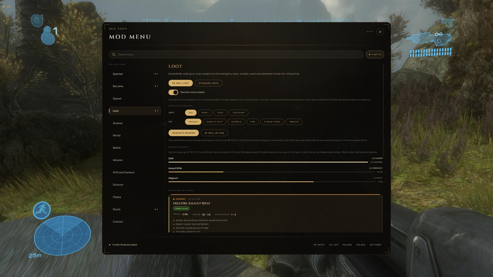
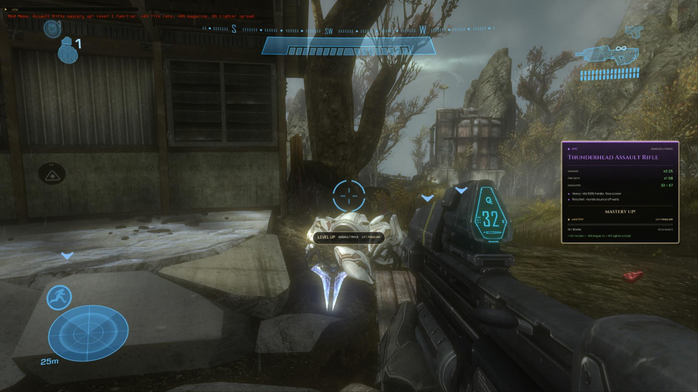
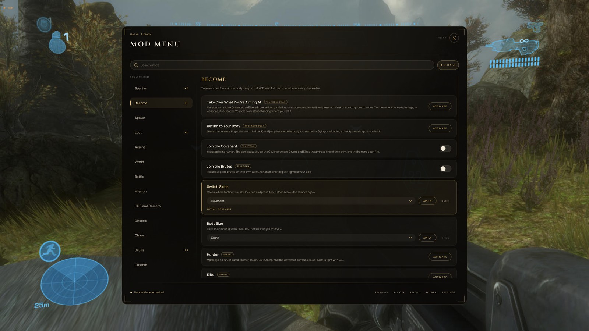

# HCM Mod Menu
*An in-game mod menu for Halo: The Master Chief Collection on PC: campaign for all six games, plus Halo: Reach Firefight. Built on [HaloCheckpointManager](https://github.com/Burnt-o/HaloCheckpointManager).*

**Download:** [latest build](../../releases/tag/latest) (`HCM-ModMenu.zip`)

## What it does

Press **Insert** in a mission and a black-and-gold menu opens over the game, with 160+ mods in 14 collections. Each game only shows the mods that work in it.

* **Borderlands-style loot (Halo: Reach).** Every gun on the level rolls a rarity (common to legendary), a maker and perks. You get faster fire, bigger magazines, multi-shot and shotgun spreads, laser accuracy, heavier hits, and elemental rounds borrowed from other guns. Crazy projectiles too: ricochet, seeking, railgun, slow drifting rounds, mortar arcs, fat rounds, flat fans, bigger blasts, headshots from any gun, and EMP hits. Every legendary gets a name, red flavour text and a special (Endless, Rocket Choir, Bounce House, Swarm, Lancer, Firehose or Wrecking Ball). When you pull a gun out, its item card slides in like a Borderlands drop.
* **Generate a Weapon.** Pick a rarity (up to guaranteed Legendary) and a gun, or Random, and a fresh roll drops in front of you. *Re-roll My Gun* re-rolls the one in your hands. *Loot Chest* drops four rolled guns at once.
* **Weapon mastery.** Kills level up each gun type: Familiar, Proficient, Veteran, Expert, Master. Every level makes that gun fire faster, hold more and shoot tighter, and progress is saved between sessions. A small "+1" pops up under the crosshair, and the gun's card shows MASTERY UP! when it levels.
* **Spawn anything the level has loaded.** Weapons, vehicles, characters, equipment and crates, dropped in front of you (Halo 3, ODST and Reach). *Load More* unlocks the vehicles and weapons a mission keeps for later.
* **Become.** A real body swap: aim at a Hunter, Elite, Brute or Marine, or spawn one, and you *are* it. Then come back to your Spartan (Reach campaign and Halo CE). There are also true team switches (join the Covenant or the Brutes) and 20+ one-press transformations across the games.
* **Third person** in every game, with its own crosshair and shield/health bars.
* **Firefight.** In Halo: Reach Firefight the menu works too: mods, God Mode, spawning, loot, Generate a Weapon, mastery and third person. Body swaps are campaign-only for now.
* **Everything else.** Spartan, Arsenal, World, Battle, Mission, HUD and Camera, Director and Chaos collections, with anti-gravity, boss armour, vehicle nitro, other worlds' gravity, ceasefires and mutinies, fireteams, photo mode and more. Live skulls show each skull's real on/off state. HCM's own cheats (God Mode, speedhack, AI freeze, free camera) are in the same menu.
* **Mods come back after deaths and reloads.** Size, camo, gravity, allegiances and other lasting mods re-apply themselves.

## How to install

1. Download `HCM-ModMenu.zip` from the [latest build](../../releases/tag/latest) and unzip it anywhere, e.g. your Desktop.
2. In Steam, press **Play** on Halo MCC and pick **"Anti-Cheat Disabled"**. The menu can't load while Easy Anti-Cheat is on, and anti-cheat must stay off anyway: this is for campaign and Firefight on your own PC, not online matchmaking.
3. Run `HaloCheckpointManager.exe` from the unzipped folder.
4. Load a campaign mission or a Halo: Reach Firefight match and press **Insert** (or press <kbd>`</kbd> for HCM's window and click *Mod Menu*).
5. Open **Loot** and press *Roll Loot* or *Generate Weapon* to start.

`MOD MENU - READ ME.txt` in the zip explains every page. Nothing on disk is changed: loot, mods and everything else are written into the game's memory while it runs. Close the game and it's all gone, except your mastery progress (`ModMenuMastery.txt`) and your own mod list.

Tested on Steam MCC 1.3528 (October 2026). Halo CE, 2, 3, ODST and Reach were swept mod-by-mod in-game; Halo 4 is checked against its script docs only.

## For tinkerers

* **Editable library.** Every mod lives in `ModMenuLibrary.xml` next to the exe. Add your own and press *Reload*, no rebuild needed.
* **Checked against the engines.** `tools/validate_modmenu_library.py` checks every command against each game's official HaloScript function list and blocks commands known to crash a game.
* **Scripted testing.** Drop a `ModMenuDev.txt` next to HCM to run mods, roll loot, spawn things or run a full self-test; results go to `ModMenuDev.log`.
* Mods are HaloScript commands sent through MCC's own engine command interface. Loot, spawning, body swaps and Firefight support read and write the game's memory directly; the offsets are documented in the source.
* Builds automatically on GitHub Actions (`.github/workflows/build.yml`).

---

# HaloCheckpointManager
*A practice tool for [Halo: The Master Chief Collection](https://store.steampowered.com/app/976730/Halo_The_Master_Chief_Collection/)*

---**Download**---  
From the [Releases page.](https://github.com/Burnt-o/HaloCheckpointManager/releases)  

---**Features**---
* Back up (dump) to file the games checkpoints, so you can inject them again at any later time. 
* UI for managing your checkpoint collection (ordering, sorting, renaming etc).
* Single-player cheats to help you practice and route the games, such as
   * Force custom checkpoints & back them up
   * Invincibility
   * Speedhack (both slow-down and fast-forward)
   * Block the games natural checkpoints
   * Teleport and Launch the player
   * And more (specific games have different features)
 * Support for multiple downpatched versions of MCC - Season 7 (2448), Season 8 (2645), and of course current patch.

---**Building from source**---   
To build the source yourself, grab the latest version of [Visual Studio](https://visualstudio.microsoft.com/) and the following workloads/components:  
 * .NET desktop development (and .NET 7.0 runtime)  
 * Desktop development with C++  
 * Windows 10 SDK (or higher)
    
HCM uses vcpkg manifest files for C++ dependecies. With Visual Studio this should all be automatic. 
I haven't tried building outside of this VS environment so YMMV if you try otherwise. 

This project also makes heavy use of the amazing SafetyHook by cursey. You can think of it as like "Microsoft Detours but if it didn't suck". I've included the release I'm using in this repository so you shouldn't need to worry about it.

After successfully building all projects (besides HCMInternalTests, that doesn't matter), make sure to rebuild the entire solution to ensure all build events fire correctly.

Known build issue: Your build events may fail to copy over certain files to the correct directory due to macro issues: fix this by adjusting the build event macros for each project to make sure they're outputting to HCMExternal's binary output directory.